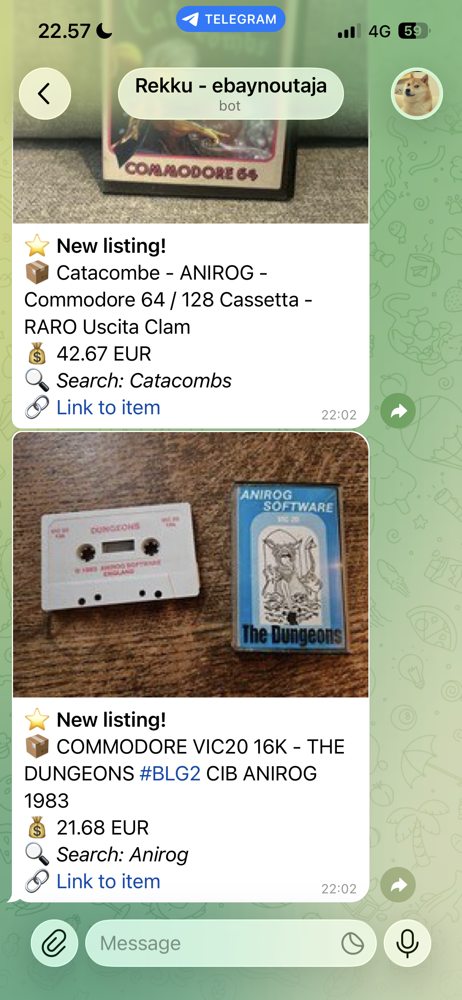
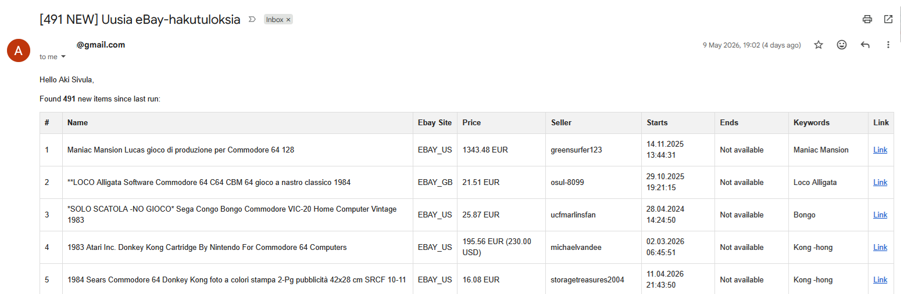

# fastebaysearch

`fastebaysearch` is a command-line Python tool for running large numbers of searches across multiple eBay marketplaces.

The tool stores listing history in SQLite and reports new items, fixed-price decreases and buying-option changes by email, Telegram or local HTML files.

<details>
<summary>Notification examples</summary>

**Telegram**



**Email**



</details>

`fastebaysearch` is based on the original **ebaysearch** script version 0.4.0 by Kalevi Kolttonen.

Original project: [ebaysearch](https://kolttonen.fi/computers_and_logic/programming/ebaysearch/ebaysearch.html).

## Features

- Concurrent searches across configured eBay marketplaces, covering fixed-price listings and auctions.
- Title-and-description search, continuation-link pagination and automatic splitting of large searches.
- SQLite history and separate delivery queues for new and changed listings.
- Telegram images, local HTML reports, currency conversion and API budget estimates.

## Requirements

- Python 3.11 or newer and Git available on your command line.
- An eBay Developer account and production application credentials (`Client ID` and `Client Secret`) with access to the Browse API. The script uses production eBay endpoints.
- SMTP credentials if email notifications are enabled.
- A Telegram bot token and chat ID if Telegram notifications are enabled. See instructions: https://www.youtube.com/watch?v=SmckRL4n1_8&t=26s

## Installation

Choose a directory where you want to keep the project. These commands create a new checkout and copy its example configuration; edit the copy for your own use.

### Debian / Ubuntu

Install Git and Python tooling, then check the Python version:

```bash
sudo apt update
sudo apt install -y git python3 python3-venv python3-pip
python3 --version
```

The version must be at least 3.11. If your distribution provides an older version, install a supported Python version before continuing.

```bash
git clone https://github.com/Rakki1/fastebaysearch.git
cd fastebaysearch
python3 -m venv .venv
.venv/bin/python -m pip install --upgrade pip
.venv/bin/python -m pip install -r requirements.txt
cp ebaysearch.example.json ebaysearch.json
```

### Windows PowerShell

Install Git and Python if needed, then check that both are available and Python is at least 3.11:

```powershell
git --version
python --version
```

```powershell
git clone https://github.com/Rakki1/fastebaysearch.git
Set-Location fastebaysearch
python -m venv .venv
.\.venv\Scripts\python.exe -m pip install --upgrade pip
.\.venv\Scripts\python.exe -m pip install -r requirements.txt
Copy-Item ebaysearch.example.json ebaysearch.json
```

Run commands from the project directory. They use the virtual environment directly; activation is unnecessary.

## First HTML search

The copied example is ready for an HTML-only collector search: **The Last Ninja** and **Impossible Mission** for Commodore 64 on eBay UK, restricted to Video Games (`139973`). It searches titles, covers auctions and fixed-price listings, and leaves email and Telegram disabled. The two game titles are quoted phrases to reduce irrelevant matches.

Open `ebaysearch.json` and replace only these credential placeholders with your own production credentials:

```json
{
  "ebay_client_id": "your-production-client-id",
  "ebay_client_secret": "your-production-client-secret"
}
```

Keep the other fields in the copied configuration. No real credentials are included in the example. No SMTP or Telegram credentials are needed while those channels are disabled; their placeholders can remain. Save valid JSON without comments or trailing commas. You can change the game titles and marketplaces later; available listings vary over time.

First estimate usage without making network calls:

Debian / Ubuntu:

```bash
.venv/bin/python fastebaysearch.py ebaysearch.json --estimate-api-budget
```

Windows PowerShell:

```powershell
.\.venv\Scripts\python.exe fastebaysearch.py ebaysearch.json --estimate-api-budget
```

If the estimate and query validation succeed, preview the current results:

Debian / Ubuntu:

```bash
.venv/bin/python fastebaysearch.py ebaysearch.json --clean-search
echo $?
```

Windows PowerShell:

```powershell
.\.venv\Scripts\python.exe fastebaysearch.py ebaysearch.json --clean-search
$LASTEXITCODE
```

The second command prints the preceding command's exit code. Check it immediately: `0` means success, `1` means an error or incomplete results/report, and `2` means eBay rate limiting. See [Logs and troubleshooting](#logs-and-troubleshooting) for details.

With these settings, open the newest `reports/ebay_report_*.html` in your browser. The log is `fastebaysearch.log` in the project directory. A successful search with zero results creates no HTML file. The first actual search requests an OAuth token and caches it in `oauth_token.json`.

Clean search is a preview: it does not read or write SQLite, mark items as seen, or send email/Telegram notifications. It does write logs, a token cache when needed, and an HTML report when results exist. It always writes HTML regardless of `use_html_report`.

If `html_report_max_per_run` omits results, the report and log show the found/reported counts and the command returns `1`. Clean search has no delivery queue; increase the limit or narrow your search for a complete report.

## Start monitoring and enable notifications

After checking the preview, choose your notification channels below and run normally.

Debian / Ubuntu:

```bash
.venv/bin/python fastebaysearch.py ebaysearch.json
echo $?
```

Windows PowerShell:

```powershell
.\.venv\Scripts\python.exe fastebaysearch.py ebaysearch.json
$LASTEXITCODE
```

On a new database, the first normal run treats all matching items as new. **A previous clean search does not suppress this initial batch.** You can keep the first-run settings for HTML-only monitoring or enable email/Telegram before running. Check the log and output before [scheduling runs](#scheduled-runs-with-cron).

Notification delivery is tracked separately for each channel. An email delivery does not mark a Telegram notification as delivered. Enabling Telegram later can therefore send previously stored items that are still pending for Telegram, including items discovered while Telegram was disabled. Email likewise processes its own pending history. Keep a per-run limit that suits the initial batch.

HTML behaves differently: only items first discovered while HTML is enabled enter its queue. Enabling HTML later does not retrospectively queue existing history. Overflow and failed writes stay queued for later runs.

### Channel settings

| Channel | Configuration |
| --- | --- |
| HTML | `use_html_report: true`; set `html_report_dir` and `html_report_max_per_run` (default **1,000**). Overflow and failed writes stay queued. |
| Email | `use_email: true`; fill in the example's `smtp_*` and `email_*` fields. `email_max_per_run` defaults to **1,000**. SMTP supports optional STARTTLS, not implicit TLS. |
| Telegram | `use_telegram: true`; set `telegram_token`, `telegram_chat_id` and `telegram_max_per_run`: **25** in the example, **1,000** if omitted. |

Email requires non-empty SMTP login/password and identity fields even when authentication is disabled. Keep unconfigured channels disabled.

Telegram's `telegram_send_mode` accepts `auto` or `photo` (image when available, text fallback), `text`, or `photo_only` (skips items without images; no fallback). `telegram_disable_web_preview` controls text-link previews. Headers and fallback requests are additional to the item limit. Failed item deliveries become eligible again after six hours, up to three claimed attempts; exhausted items remain stored but are not automatically retried.

### Changed listings and status alerts

Seen listings are refreshed on every observation. A separate durable event queue reports fixed purchase-price decreases and changes between AUCTION and FIXED_PRICE. Bid changes, title edits and currency-conversion changes do not trigger alerts. Price comparisons require the same currency and source marketplace. Responses from the listing's own marketplace take priority; otherwise the first configured marketplace wins.

The first structured observation of an older listing establishes a baseline without a change alert. A channel whose initial listing notification is pending receives the latest details in that notification. New and changed listings share each channel's per-run limit, with the oldest pending entries selected first.

Every partial or failed search run sends one summary per enabled channel even with no pending listings. HTML writes a status-only report when necessary. Successful empty runs remain silent. Successful Telegram reports omit the search-status line. Telegram truncates long diagnostic details with a pointer to the log. Channel failures do not block other channels.

## Run modes

Listing searches and budget estimates validate the configuration, including credentials for enabled channels. Disable email/Telegram for a preview when you have not configured their credentials. Category lookup needs only eBay credentials, `ebay_sites`, and the optional token-cache path.

| Mode | API calls | SQLite | Output |
| --- | --- | --- | --- |
| Normal run (no flag) | eBay searches, OAuth as needed, exchange rates on cache miss | Reads/writes history, seen items and delivery state | Enabled HTML, email and Telegram channels, including pending deliveries |
| `--clean-search` | eBay searches, OAuth as needed, live exchange rates | No access | Local HTML preview only; no email/Telegram or delivery queue |
| `--estimate-api-budget` | None | No access | Console estimate only; no token cache, log file or notifications |
| `--find-categories "keywords"` | Taxonomy lookups, OAuth as needed | No access | Category names, paths and a configuration example on the console; no listings, reports or notifications |

The three command-line modes cannot be combined.

## Search settings

Settings are top-level JSON fields unless shown with a dotted path. See [ebaysearch.example.json](ebaysearch.example.json) for the full configuration.

| Setting | Purpose / default |
| --- | --- |
| `ebay_sites` | Marketplaces such as `EBAY_GB`, `EBAY_US` and `EBAY_DE`. |
| `ebay_buying_options` | `["FIXED_PRICE", "AUCTION"]` by default; either value alone restricts the listing format. |
| `ebay_search_in_description` | `true`: search titles and descriptions. Set `false` for title search. The example uses `false`; defaults to `true` when omitted. |
| `ebay_search_keywords.base_terms` | Each expression generates a query on every configured marketplace. |
| `ebay_search_keywords.required_terms` | At least one alternative must match. Use `[]` to omit the restriction. |
| `exclude_terms` | Exclusions appended to every query. |
| `ebay_category_ids` | Search only these category IDs per marketplace; default `{}` (all categories). |
| `ebay_exclude_category_ids` | Excluded category IDs per marketplace; default `{}` (no exclusions). |
| `ebay_max_search_calls_per_run` | Shared Browse request cap, including retries: **500** per run. |
| `api_concurrency` | Maximum concurrent Browse requests: **8**. |
| `exchange_rate_cache_ttl_hours` | Exchange-rate cache lifetime: **24** hours; `0` disables caching. |

### Category filters

Find category IDs directly from the command line using your configured marketplaces:

Linux:

```bash
.venv/bin/python fastebaysearch.py ebaysearch.json --find-categories "commodore 64"
```

Windows PowerShell:

```powershell
.\.venv\Scripts\python.exe fastebaysearch.py ebaysearch.json --find-categories "commodore 64"
```

Example output (suggestions vary by marketplace and over time):

```text
EBAY_GB
  Video Games & Consoles [1249] > Video Games [139973]
```

The command prints eBay's ranked suggestions and a JSON example containing the first suggestion for each successful marketplace. Choose the IDs before copying them into your configuration; you can also use a parent ID from the paths, such as `1249`. It does not change your configuration, access SQLite, fetch listings, or send notifications. It may update the OAuth token cache. Existing category filters and listing keywords do not restrict the lookup. Suggestions are not a complete category listing.

Normally this uses two Taxonomy calls per marketplace, plus OAuth if needed; transient errors can add retries. These are separate from Browse calls and the Browse budget estimate. Exit codes are `0` for success (including no suggestions), `1` for an error, and `2` for rate limiting. Errors appear on the console; successful marketplaces are retained in partial output. Missing marketplaces in a copied JSON example remain unrestricted.

To restrict searches to video games, add the following top-level setting:

```json
{
  "ebay_category_ids": {
    "EBAY_GB": ["139973"],
    "EBAY_US": ["139973"],
    "EBAY_DE": ["139973"],
    "EBAY_AU": ["139973"],
    "EBAY_FR": ["139973"],
    "EBAY_IT": ["139973"]
  }
}
```

`139973` is Video Games on these six marketplaces; it includes modern games too, so keep your C64/game keywords. Optionally add `"4193"` (Other Vintage Computing) to find listings outside Video Games, at the cost of broader results. Misclassified games outside the selected categories will be missed. The starter configuration uses only `EBAY_GB` and `139973`.

eBay's [category_ids parameter](https://developer.ebay.com/develop/api/buy/browse_api/item/search) accepts one category per request. Multiple configured IDs are searched separately and duplicate item IDs are merged before delivery. With 13 queries and six marketplaces, one category requires at least 78 Browse calls; two require 156. Pagination and retries add calls, within the shared per-run cap. The budget estimate includes these category searches. Logs identify each category; an invalid-category API warning fails that search instead of accepting unrestricted results. Missing marketplace entries or `[]` mean all categories.

For broader searches, you can optionally exclude vehicle parts with the following setting. The starter configuration does not need these exclusions because it searches only Video Games:

```json
{
  "ebay_exclude_category_ids": {
    "EBAY_GB": ["131090"],
    "EBAY_US": ["6028"],
    "EBAY_DE": ["131090"],
    "EBAY_AU": ["131090"],
    "EBAY_FR": ["131090"],
    "EBAY_IT": ["131090"]
  }
}
```

To find an ID, search on the relevant country's eBay site, select a category, and check the address bar. For example, this link searches for Commodore 64 in the UK Video Games category:

[https://www.ebay.co.uk/sch/i.html?_nkw=commodore+64&_sacat=139973](https://www.ebay.co.uk/sch/i.html?_nkw=commodore+64&_sacat=139973)

The number after `_sacat=` is the category ID: **139973**. The `.co.uk` site corresponds to **EBAY_GB**. To search only this category, add the following top-level setting:

```json
{
  "ebay_category_ids": {"EBAY_GB": ["139973"]}
}
```

Some URLs put the ID in the path instead: in `https://www.ebay.co.uk/sch/139973/i.html`, it is the number between `/sch/` and `/i.html`. A `bn_...` identifier is not a category ID; if no numeric category ID is visible, use eBay's [category information / Taxonomy API](https://developer.ebay.com/develop/guides/buy/marketplace-metadata-guide).

IDs can differ between marketplaces. Use `ebay_category_ids` to include categories or `ebay_exclude_category_ids` to exclude them. For example, `"EBAY_GB": ["131090", "15032"]` inside `ebay_exclude_category_ids` excludes Vehicle Parts & Accessories and Mobile Phones & Communication. Remove a marketplace entry or use `[]` to disable that setting's restriction for the marketplace.

The [excludeCategoryIds filter](https://developer.ebay.com/api-docs/buy/static/ref-buy-browse-filters.html) applies to all pages and time-range searches without extending the keyword query. Check the results with `--clean-search`; miscategorised listings can still appear. Existing database records and queued notifications are not removed. Keep personal configuration and generated HTML reports out of Git.

### Search expressions and coverage

Search terms separated by spaces retain eBay's AND semantics. For example, base term `camera` and required terms `["canon", "nikon"]` produce `("canon", "nikon") camera`. Expressions such as `(Slapshot, "Slap Shot")` and `Kong -hong` are preserved. Exclusions are appended to every query; an optional leading minus on a configured exclusion is normalized.

Every complete query, including all exclusions, must fit within eBay's 100-character limit. An overlong query is rejected with its base term, full text and length before logging, database access or API calls. This applies to normal runs, clean searches and budget estimates. Shorten the terms or split the configuration; no exclusions are silently discarded.

Results are ordered newest first and paginated using the API's continuation link. Searches reaching 10,000 results are split into listing-start time ranges and duplicate IDs are merged. All searches share the **500-call per-run cap**, including retries; OAuth and exchange-rate requests are separate. A budget stop or unsplittable interval is reported as `truncated`, with received results retained. Each run starts afresh rather than resuming unfinished ranges; complete coverage is not guaranteed for changing inventory or budget-limited searches.

Description search can find items omitted from listing titles but may return more irrelevant matches. `required_terms` and exclusions still apply. Auction-only listings show `Current bid`; missing prices display `Price unavailable`.

Temporary API failures receive up to two retries; authentication errors allow one shared token refresh. Rate limiting stops outstanding searches. Results already received are retained, and incomplete runs are identified in logs and notifications.

## API budget and scheduling

The program defaults to **10,000 Browse calls per day for its calculation**. Check your own application's Browse quota and current usage in your eBay developer account and set `ebay_daily_api_limit` accordingly before scheduling. Changing this field does not change eBay's quota or enforce a local daily request counter.

These optional fields control the estimate:

```json
{
  "ebay_daily_api_limit": 10000,
  "api_budget_safety_percent": 90,
  "estimated_results_per_query": 200
}
```

Run `--estimate-api-budget` using the commands in [First HTML search](#first-html-search). The estimate uses the number of marketplaces, generated queries and expected result pages. Each marketplace/query combination makes a separate request for each page; a run is not one API call for all marketplaces.

The output shows estimated calls per run, possible runs per day and a recommended interval. It also shows a retry allowance at the estimated page count and the configured per-run Browse call cap. OAuth calls are separate (0–2 per run). The recommended interval uses the normal estimate; allow headroom for retries, other applications using the same quota and higher result counts. Automatic time-range splitting can increase usage beyond the estimate. The 500-call cap is per run, not a daily quota controller.

### Scheduled runs with cron

After a successful manual run, use absolute paths and the same working directory for cron. Replace every `/home/user/fastebaysearch` with your checkout's absolute path. The following is a 30-minute example, not a universal interval recommendation:

```cron
*/30 * * * * cd /home/user/fastebaysearch && /home/user/fastebaysearch/.venv/bin/python /home/user/fastebaysearch/fastebaysearch.py /home/user/fastebaysearch/ebaysearch.json >> /home/user/fastebaysearch/cron.log 2>&1
```

Choose an interval that fits your API budget and leaves enough time for a run to finish. Avoid overlapping scheduled runs; SQLite delivery tracking does not make every notification channel immune to duplicate delivery. This command uses the virtual environment without activating it.

## Logs and troubleshooting

The script writes `fastebaysearch.log` in the project directory. It rotates at `log_max_size_mb` and retains up to five backups. With `log_to_console: true`, runtime messages also appear in the terminal. Configuration errors are printed before the log is opened.

Exit codes:

- `0`: all searches completed and attempted notifications/reports succeeded. Items safely queued beyond the normal HTML limit do not make the run fail.
- `1`: configuration, database, token, notification or other runtime error; also an incomplete search or truncated clean-search report.
- `2`: eBay rate limiting was encountered; takes precedence over notification/report failures. Results received before the search cancellation are still processed.

A failed or partial search is not equivalent to a successful search with zero results. Check the per-query status, fetched counts and notification errors in the log.

| Symptom | What to check |
| --- | --- |
| Configuration error | Valid JSON, required fields for enabled channels, allowed paths, and the full query's 100-character limit |
| No HTML report | Whether the search succeeded with zero results; in normal mode, whether HTML is enabled and its queue has pending items |
| `PARTIAL SEARCH` or a call-budget stop | Affected queries and API errors in the log; narrow broad searches |
| Clean report contains fewer items than were found | `html_report_max_per_run`; clean search cannot queue the remainder |
| HTTP 401 | Production eBay credentials and application access; the run already attempts one shared token refresh |
| HTTP 429 / exit code 2 | Actual application quota and request frequency before the next run |
| Email or Telegram fails | Channel credentials, settings and logs; the other enabled channels are still attempted |

## Updating

1. Stop scheduled runs and back up your configuration and SQLite database. Use SQLite's backup facility, or stop all database users before copying the database and any WAL files.
2. Review the [release notes](https://github.com/Rakki1/fastebaysearch/releases), then update the code and dependencies using the commands below.
3. Compare your settings with `ebaysearch.example.json`, keeping your credentials and search terms. Database schema updates run automatically and preserve existing history.
4. Run once manually, check the log and exit code, then resume scheduling. Broader search defaults can increase the first result batch.

Replace the project path below with your installation directory. Run these commands after stopping scheduled runs and taking the backup.

### Linux

```bash
cd /path/to/fastebaysearch
git pull --ff-only
.venv/bin/python -m pip install -r requirements.txt
```

### Windows PowerShell

```powershell
Set-Location C:\path\to\fastebaysearch
git pull --ff-only
.\.venv\Scripts\python.exe -m pip install -r requirements.txt
```

If a command fails, resolve the error before continuing. Keep your existing configuration file; do not overwrite it with the example.

## Local credentials

Copy `ebaysearch.example.json` to create your own configuration; keep real credentials out of Git. The default local configuration and token cache names are ignored. `konfiguraatio.json` is also an ignored personal filename, not a configuration supplied by the repository. Add custom credential or cache filenames to `.gitignore` before committing.

Tests use a credential-free collector-search fixture. Do not replace it with a live configuration.

## Tests

Install development dependencies and run the test suite from the project directory.

Debian / Ubuntu:

```bash
.venv/bin/python -m pip install -r requirements-dev.txt
.venv/bin/python -m pytest -q
```

Windows PowerShell:

```powershell
.\.venv\Scripts\python.exe -m pip install -r requirements-dev.txt
.\.venv\Scripts\python.exe -m pytest -q
```
